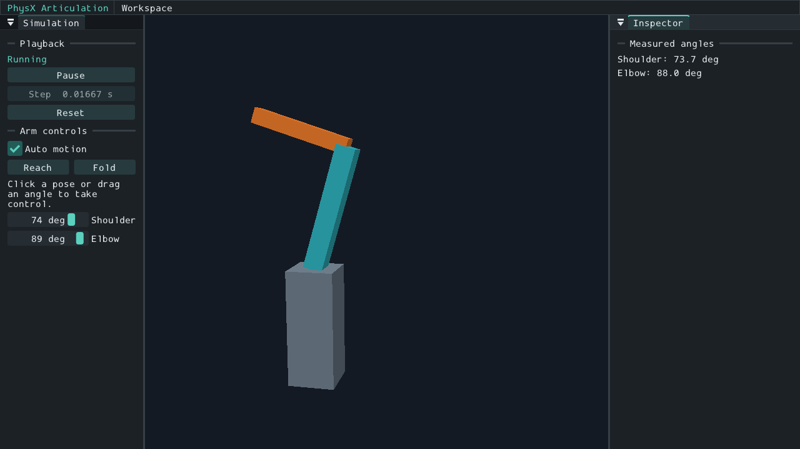

# Articulation

启动后，青色上臂和橙色前臂会自动伸展、折叠，每四秒完成一次往返。要接管机械臂，直接操作左侧 **Simulation → Arm controls**：

- 点 **Reach** 伸展，点 **Fold** 折叠。点任何一个都会关闭自动运动，机械臂到达指定姿态后会保持。
- 拖 **Shoulder** 带动两节臂，拖 **Elbow** 让前臂相对上臂弯折。滑块也会接管自动运动；重新勾选 **Auto motion** 即可恢复。



在仓库根目录运行：

```sh
cmake -S . -B build
cmake --build build --target Articulation
./build/Articulation/Articulation
```

左侧滑块显示驱动的**目标角度**，右侧显示 PhysX 求解出的**实际角度**。想看两者的区别，可以先点 **Pause**，再点 **Fold**：此时只有目标改变；按 **Step** 推进 1/60 秒，机械臂才开始追向目标。**Reset** 回到伸展姿态并重启自动周期；若已暂停，则按 **Resume** 继续。

从 [ArmWorld.cpp](src/ArmWorld.cpp) 开始读：先创建一个 `PxArticulationReducedCoordinate`，再按“基座 → 上臂 → 前臂”建立父子连杆。每个子连杆通过自己的入站关节连接父连杆；父端与子端的局部锚点在世界中是同一个转轴。滑块只改驱动目标，连杆姿态由物理求解器计算。[ArmView.cpp](src/ArmView.cpp) 读取这些姿态绘制机械臂，复用工作台和方块网格。
