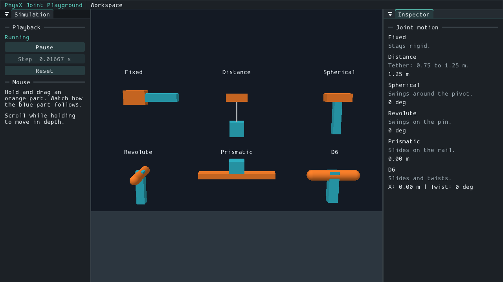

# JointPlayground

按住橙色零件并拖动，观察蓝色零件怎样跟随；按住时滚轮控制前后深度。橙色零件是运动学刚体，蓝色零件是动态刚体。每组只有这两个零件和一个 PhysX 关节。名称直接标在场景中，灰色地面在 `y = 0` 参与碰撞。



| 位置 | 关节 | 试着这样拖 |
| --- | --- | --- |
| 左上 | Fixed（固定） | 拖橙色板；蓝板和它一起移动，接缝始终不变。 |
| 中上 | Distance（距离） | 左右拉动悬点；蓝色重物能摆动，两端中心距离受 0.75–1.25 m 限制。细绳表示当前距离。 |
| 右上 | Spherical（球形） | 左右拖动，再滚轮前后拖；摆臂可以向不同方向倾斜，顶端始终连在支座上。 |
| 左下 | Revolute（铰链） | 左右晃动橙色销轴；蓝色手柄像钟摆一样，只能绕销轴转动。 |
| 中下 | Prismatic（滑动） | 抓橙色导轨左右拖；蓝色滑块能沿导轨移动。上下拖，滑块和导轨一起升降。 |
| 右下 | D6 | 左右拖橙色轴让蓝色曲柄沿轴相对滑动；再用滚轮前后移动轴，看曲柄绕轴摆动。右侧分别显示轴向位移和扭转角。 |

在仓库根目录运行：

```sh
cmake -S . -B build
cmake --build build --target JointPlayground
./build/JointPlayground/JointPlayground
```

`Pause`、`Step` 和 `Reset` 对六组同时生效。想看某个关节怎么写，直接看 [JointWorld.cpp](src/JointWorld.cpp) 中 `createDemo` 对应的 `case`：两件刚体在哪里、关节在两侧的局部连接点在哪里、允许哪些运动，都在同一处。[JointView.cpp](src/JointView.cpp) 负责拾取射线、零件绘制和名称显示。
